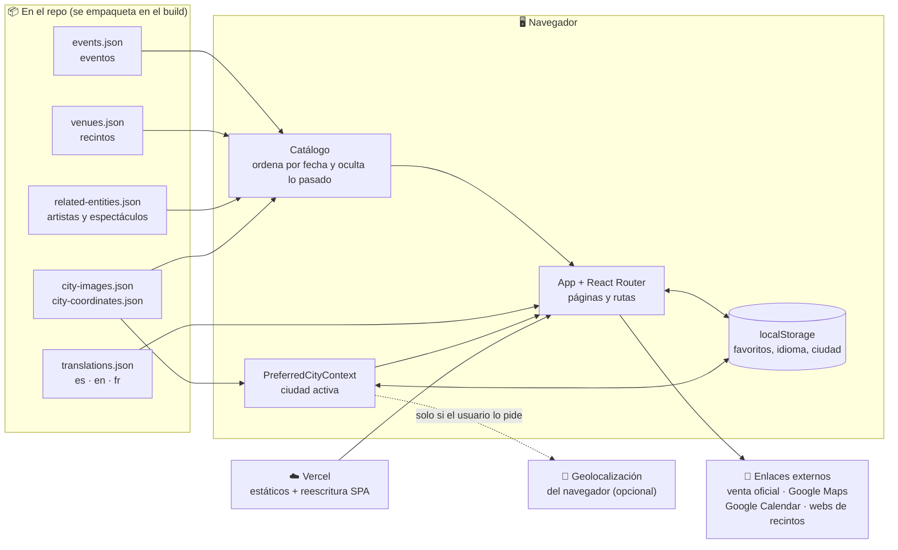
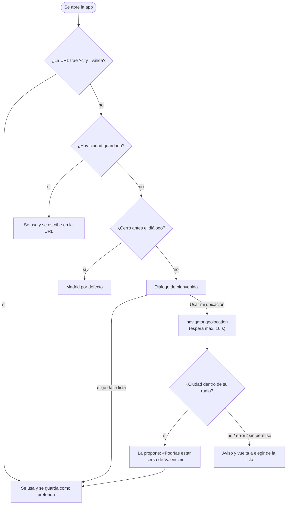
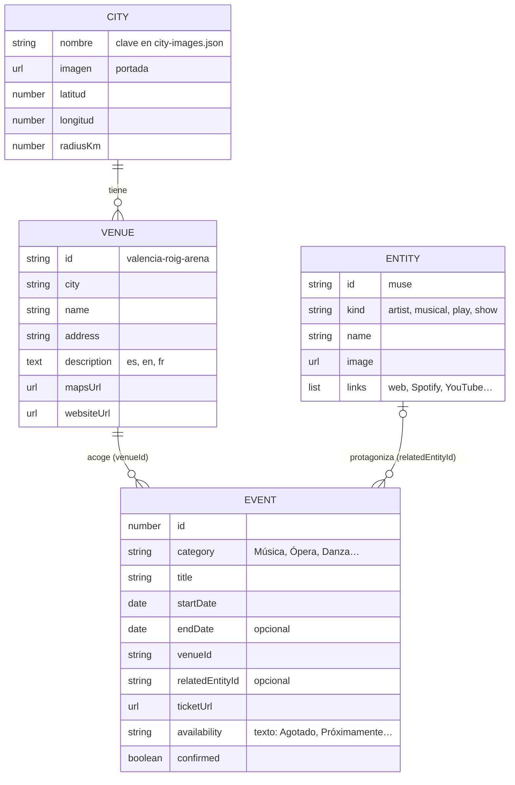

<div align="center">


# Plan Cerca

**Conciertos, teatro, ópera, danza, exposiciones y deporte en tu ciudad, en un solo sitio.**

*Concerts, theatre, opera, dance, exhibitions and sport in your city, all in one place.*


**[🌐 plancerca.com](https://plancerca.com)** · **[📸 Guía visual](docs/GUIA-VISUAL.md)** · **[📖 Manual de uso](docs/MANUAL-DE-USO.md)** · **[📝 Registro de cambios de la interfaz](docs/CHANGELOG-UI.md)**

</div>

---

## Qué es

Plan Cerca es una agenda cultural y deportiva para seis ciudades de España: **Madrid, Barcelona, Valencia, Sevilla, Bilbao y Albacete**. Eliges ciudad, ves qué hay hoy, mañana o este mes, guardas lo que te interesa y, desde cada ficha, llegas a la web oficial para comprar la entrada.

Es el trabajo de la asignatura **«HCI: Desarrollo web y móvil»**. Por eso este README empieza por el **diseño de la interfaz**: cómo se trabajó, qué se decidió y por qué. La parte técnica va después.

> **En cifras (20 de noviembre de 2026):** 320 eventos próximos (380 en el catálogo), 51 recintos y 11 fichas de artista o espectáculo, en español, inglés y francés. Los eventos que ya han pasado se ocultan solos.
>
> **plancerca.com** muestra una página de «Próximamente» hasta el lanzamiento; la app completa se ve en local (`pnpm dev`) y en las vistas previas de Vercel.

## Índice

**Diseño de la interfaz**

1. [Cómo se trabajó](#-cómo-se-trabajó)
2. [Decisiones de diseño](#-decisiones-de-diseño)
3. [Accesibilidad](#-accesibilidad)
4. [Antes y después](#-antes-y-después)
5. [Limitaciones](#-limitaciones)

**Cómo está hecho**

6. [Arquitectura](#-arquitectura)
7. [Qué pasa al abrir la app: elegir ciudad](#-qué-pasa-al-abrir-la-app-elegir-ciudad)
8. [Herramientas](#-herramientas)
9. [La URL como estado](#-la-url-como-estado)
10. [Datos](#-datos)
11. [Búsqueda, filtros y recomendaciones](#-búsqueda-filtros-y-recomendaciones)
12. [La ficha de evento](#-la-ficha-de-evento)
13. [Idiomas](#-idiomas)
14. [Buscadores y agentes de IA](#-buscadores-y-agentes-de-ia)
15. [Rendimiento](#-rendimiento)
16. [Despliegue](#-despliegue)
17. [Arrancarlo en local](#-arrancarlo-en-local)
18. [Estructura del repositorio](#-estructura-del-repositorio)
19. [Créditos de las imágenes](#-créditos-de-las-imágenes)

---

# Diseño de la interfaz

## 🧭 Cómo se trabajó

1. **Auditoría inicial (7 de noviembre de 2026).** Revisión automática con axe (reglas WCAG 2.0, 2.1 y 2.2, niveles A y AA) de las cuatro pantallas clave en móvil (390 px) y escritorio (1440 px), más medidas propias. axe no encontró errores, pero las medidas sí:
   - entre 10 y 38 controles por pantalla medían menos de 44 px;
   - las tarjetas no tenían encabezado, así que con un lector de pantalla no se podía saltar de una a otra;
   - cada tarjeta medía hasta 614 px de alto, con 11 textos y 3 enlaces al mismo sitio;
   - había valoraciones y «% de popularidad» sin ninguna fuente.

   El resultado completo está en [docs/PLAN-UI.md](docs/PLAN-UI.md).
2. **Iteraciones pequeñas, por prioridad:**
   - P0, datos y despliegue;
   - P1, lo que pide el enunciado y la accesibilidad;
   - P2, consistencia y jerarquía;
   - P3, pulido visual.

   Cada iteración es un cambio coherente con su commit. Su porqué (la heurística de Nielsen o el criterio WCAG que lo justifica) queda en el [registro de cambios de la interfaz](docs/CHANGELOG-UI.md).
3. **Comprobación tras cada cambio:**
   - 295 pruebas automáticas;
   - axe en todas las páginas y estados, en móvil y escritorio y en los dos modos de color;
   - contraste del texto sobre las fotos de portada;
   - tamaños de 320 a 1440 px;
   - recorrido con teclado.
4. **Auditoría visual final.** Una revisión buscó señales de interfaz genérica: 24 etiquetas de color compitiendo en la misma pantalla, mayúsculas espaciadas, degradados de color sobre las fotos. De ahí salió el pulido P3.
5. **Capturas antes y después** de las mismas pantallas, en [docs/capturas/](docs/capturas/).

Las decisiones de producto que no salen del código (por ejemplo, aceptar los carteles oficiales en un trabajo sin ánimo comercial) están en [DECISIONES.md](DECISIONES.md).

## 🧩 Decisiones de diseño

Las heurísticas se citan por su número en la lista de Nielsen: N1 visibilidad del estado del sistema, N3 control y libertad, N4 consistencia, N5 prevención de errores, N6 reconocer mejor que recordar, N7 flexibilidad y eficiencia, N8 diseño estético y minimalista, N9 ayudar a reconocer y recuperarse de errores.

| Decisión | Qué se hizo | Por qué |
|---|---|---|
| **La ciudad, lo primero** | Un diálogo de bienvenida para elegirla. La ubicación solo se pide si se pulsa «Usar mi ubicación», y nunca sale del dispositivo | Todo lo que se ve depende de la ciudad (N1). La persona decide si comparte su ubicación (N3) |
| **Atajos de fecha en la portada** | Hoy, Mañana, Esta semana y Próximos 30 días, con su recuento. Los que están a cero no aparecen; queda un aviso con un enlace a los próximos días | Un toque filtra el catálogo (N7). Sin botones que no llevan a ninguna parte (N8, N5) |
| **Tarjeta de evento compacta** | Imagen con la fecha como en una entrada, título, lugar y hora, precio si se conoce y corazón. Un solo enlace y un solo botón por tarjeta | Antes tenía 11 textos y 3 enlaces al mismo destino (N8, WCAG 2.4.4). La fecha se lee de un vistazo, como en un calendario (N6) |
| **Una misma tarjeta en toda la web** | La misma en Recomendados, catálogo, búsqueda, favoritos y ficha | Se aprende una vez y sirve en todas partes (N4) |
| **Filtros con recuento en vivo** | Panel lateral en escritorio y hoja inferior en móvil. El botón dice cuántos resultados saldrán y cada filtro activo es un chip que se quita con un toque | Se ve qué está filtrado antes de aplicar (N1) y se deshace sin volver a abrir el panel (N3). No deja aplicar una combinación vacía (N5). El calendario marca los días con eventos (N6) |
| **Búsqueda que perdona** | Ignora tildes y mayúsculas. Si no hay nada en tu ciudad, ofrece las ciudades donde sí | Prevenir el error y ofrecer una salida (N5, N9) |
| **Ficha: lo importante arriba** | Qué, cuándo, dónde y precio en el primer pantallazo. La compra siempre a mano: tarjeta fija en escritorio y barra inferior en móvil. La reserva de demostración es un enlace para que no compita con la compra | Jerarquía visual: una sola acción principal por pantalla (N8) |
| **Favoritos que perdonan** | Próximos y pasados por separado, deshacer al quitar, añadir todos al calendario y compartir la lista | Un toque por error no cuesta nada (N3). Cada acción confirma lo que ha hecho (N1) y se trabaja con todos a la vez (N7) |
| **Datos honestos** | Se quitaron las valoraciones y el «% de popularidad», que no tenían fuente. «Gran evento» se basa en un dato verificable: aforo de 10.000 personas o más | Credibilidad. La escala del evento se reconoce de un vistazo (N6) |
| **Errores con salida** | Un evento que ya ha pasado no da error: lo dice y propone tres parecidos. La página 404 está traducida y enlaza a la portada | Nunca un callejón sin salida (N9) |
| **Color con significado** | Navegación en azul, un color de marca fuerte como el de las webs de venta de entradas (por ejemplo, Ticketmaster). Tarjetas claras para que mande el cartel. Un solo acento, ámbar, para la acción principal, y un color por categoría | Antes competían 24 etiquetas de color y nada destacaba (N8). Un mismo color significa siempre lo mismo (N4) |
| **Modo noche opcional** | Grafito y ámbar. Se activa desde la cabecera (a cualquier ancho de pantalla), el menú de perfil o «Tu perfil», y se recuerda | La persona elige (N3). El negro es una preferencia, no una imposición |
| **Fotos de ciudad legibles** | La sombra solo va detrás del texto y el resto de la foto queda a la vista. El contraste se mide en las seis ciudades | WCAG 1.4.3: el texto llega a 4,5:1 sobre el punto más claro de la foto |
| **Móvil primero** | 44 px en todo lo que se pulsa. La cabecera mantiene la ciudad, el idioma y el modo noche hasta 320 px sin desbordar | WCAG 2.5.5 (nivel AAA, y lo que recomiendan Apple y Android) y 1.4.10 |
| **Tres idiomas** | Español, inglés y francés. El idioma del documento cambia con la elección | Para quien visita la ciudad desde fuera. Los lectores de pantalla pronuncian bien (WCAG 3.1.1) |
| **Privacidad por diseño** | Sin cookies ni servicios de terceros. Nada se guarda solo por visitar la web. «Tus datos» descarga o borra todo | Confianza y RGPD, sin patrones oscuros |

## ♿ Accesibilidad

El objetivo es **WCAG 2.2 AA**, más un área táctil de **44 px** (nivel AAA 2.5.5).

**Resultado medido:**

- **axe sin problemas en 194 comprobaciones:** todas las páginas y estados (menús, filtros, diálogos, reserva), en móvil y escritorio, en el modo azul y en el modo noche.
- **Zoom al 200 %** sin desplazamiento horizontal en ninguna página (WCAG 1.4.10).
- **Contraste:**
  - en el modo azul, texto blanco sobre el fondo a 9,2:1 y texto de las tarjetas a 15:1;
  - sobre las fotos de portada, 5,55:1 en el peor caso (Madrid, en móvil); `pnpm check:contraste` lo mide con el píxel más claro detrás del texto;
  - unas pruebas automáticas comprueban la paleta de cada modo.

**Cómo se consigue:**

- **Navegación con teclado:**
  - enlace «Saltar al contenido»;
  - el foco pasa al `<main>` en cada cambio de página;
  - el foco se ve siempre.
- **Diálogos accesibles:** bienvenida, «Acerca de» y filtros.
  - `role="dialog"` y `aria-modal`;
  - el foco no se escapa a la página de detrás y se cierran con Escape;
  - al cerrarse, el foco vuelve al botón que los abrió.
- **Estados anunciados:**
  - `aria-pressed` en guardar, categorías y modo noche;
  - recuentos y avisos en regiones `aria-live` o `role="status"`.
- **Encabezados:** un `h1` por página, un `h2` por sección y cada tarjeta con su encabezado, para poder recorrerlas con un lector de pantalla.
- **Calendario de filtros:** patrón *grid* de WAI-ARIA, con flechas, Inicio y Fin. Cada día se anuncia con su número de eventos.
- **Movimiento:** con «reducir movimiento» se quitan las animaciones y el desplazamiento suave.

**Pendiente:** probarlo con un lector de pantalla real (NVDA o VoiceOver). La revisión automática no lo sustituye. Ver [docs/legal/ACCESIBILIDAD.md](docs/legal/ACCESIBILIDAD.md).

## 🔄 Antes y después

| | Antes (7 de noviembre) | Ahora |
|---|---|---|
| **Portada** |  |  |
| **Ficha en móvil** |  |  |
| **Modo noche** | — |  |

Las mismas pantallas (inicio, filtros, búsqueda, ficha y favoritos, en móvil y escritorio y a página completa) están en [docs/capturas/antes](docs/capturas/antes/), [docs/capturas/final](docs/capturas/final/) y [docs/capturas/final-noche](docs/capturas/final-noche/).

## 🚧 Limitaciones

Plan Cerca es una web estática, sin servidor propio ni base de datos. Por eso:

- **No hay avisos por correo.** «Seguir artista» y «Avisarme» guardan la preferencia, pero no envían nada.
- **No hay cuentas.** El perfil y los favoritos se guardan en el navegador.
- **No se venden entradas.** La compra se hace en la web oficial; «Probar la reserva» es una demostración.
- **El catálogo se actualiza a mano.**

El detalle, con lo que queda de rendimiento y accesibilidad, está en [docs/LIMITACIONES.md](docs/LIMITACIONES.md).

---

# Cómo está hecho

## 🧱 Arquitectura

Es una SPA de React servida como estáticos desde Vercel. No hay API propia: los datos se importan como módulos JSON en el build y lo que elige el usuario se queda en su navegador. Hacia fuera solo salen enlaces (venta de entradas, mapas, calendario) e imágenes.



**Decisiones que se notan:**

- **Datos en el bundle, no en una API.** Con unos cientos de eventos curados a mano, un JSON tipado es más simple que una base de datos y hace que la web cargue sin esperas de red.
- **Un contexto, no una librería de estado.** Lo único compartido de verdad es la ciudad activa (`PreferredCityContext`). El resto vive en la URL o en estado local de cada página.
- **`ErrorBoundary` en la raíz.** Si algo falla al renderizar, se muestra una página de error traducida con un enlace a la portada en vez de una pantalla en blanco.

---

## 📍 Qué pasa al abrir la app: elegir ciudad

La ciudad decide todo lo que se ve, así que hay un orden de prioridad claro. La ubicación **nunca se pide sin que el usuario pulse** «Usar mi ubicación».



- **Distancia real.** `cityNearCoordinates` calcula la distancia *haversine* a cada ciudad y solo acepta la más cercana si está dentro de su `radiusKm` (de 65 a 80 km según la ciudad, en `city-coordinates.json`).
- **Nunca se queda «buscando».** Un temporizador de 10 s cubre el caso de que el navegador no responda ni sí ni no al permiso.
- **Un enlace compartido manda.** Si llega un `?city=` distinto (por ejemplo, desde un enlace o con Atrás), sustituye a la ciudad guardada.
- **Cambiar de ciudad desde una ficha** (evento, artista o favoritos) lleva a la portada, porque esa ficha puede no existir en la nueva ciudad.

---

## 🧰 Herramientas

| Capa | Tecnología | Por qué |
|---|---|---|
| UI | **React 19** | Componentes y estado local; nada más hace falta |
| Rutas | **React Router 7** | URLs reales, compartibles y con historial |
| Lenguaje | **TypeScript 5.7** | Los JSON se leen con tipos propios (`EventItem`, `Venue`, `City`…), así que el código que los usa está comprobado |
| Estilos | **Tailwind CSS 4** + CSS propio (`src/index.css`) | Modo azul por defecto y modo noche con variables de color, un color por categoría y *media queries* para móvil |
| Build | **Vite 8** | Arranque instantáneo y recarga en caliente |
| Formato | **oxfmt** | Formateador rápido, sin configuración |
| Tipografías | **DM Sans** y **Manrope** (`@fontsource`, autoalojadas) | Se sirven desde el propio dominio: ninguna petición a Google Fonts |
| Pruebas | **Vitest** + Testing Library, **Playwright** + **axe-core** | Pruebas unitarias y comprobaciones en navegador real (accesibilidad, terceros, CSP, tamaños de pantalla) |
| Despliegue | **Vercel** | Estáticos con reescritura SPA y cabeceras propias |
| Origen | **Figma Make** | El prototipo inicial salió de ahí; quedan sus *plugins* de Vite en `vite.config.ts` |

**Sin dependencias extra:** no hay librería de estado, ni de fechas, ni de iconos, ni de i18n. Los iconos son SVG propios (`Icon.tsx`) y las fechas se calculan con `Intl` nativo.

---

## 🔗 La URL como estado

Todo lo que define «qué estoy viendo» está en la URL, así que copiar la barra de direcciones es compartir exactamente esa vista.

| Parámetro | Ejemplo | Qué hace |
|---|---|---|
| `city` | `?city=Sevilla` | Ciudad activa |
| `q` | `/search?q=rock` | Texto buscado |
| `cat` | `&cat=Música,Teatro` | Categorías marcadas (se pueden combinar) |
| `when` | `&when=week` | `today`, `tomorrow`, `week` (hasta el domingo), `month` (30 días) o una fecha `AAAA-MM-DD` |
| `filters` | `&filters=1` | Abre la pantalla de filtros sobre la búsqueda actual |

| Ruta | Página |
|---|---|
| `/` | Portada con la agenda de la ciudad |
| `/search` | Resultados de búsqueda, o filtros si no hay `q` |
| `/event/:id` | Ficha de evento (o aviso de «ya ha pasado») |
| `/venues` · `/venues/:id` | Directorio y ficha de recinto |
| `/artist/:slug` · `/entity/:slug` | Ficha de artista, musical o espectáculo |
| `/favorites` | Favoritos (próximos y pasados) |
| `/event/:id/reservar` | Reserva de demostración en cuatro pasos |
| `/perfil` | «Tu perfil»: avatar, ciudad, categorías favoritas, idioma y modo noche |
| `/tus-datos` · `/aviso-legal` · `/privacidad` · `/cookies` · `/terminos` · `/accesibilidad` | Zona legal y descarga o borrado de los datos guardados |
| `*` | Página 404 traducida |

**Detalles de navegación:**

- **Scroll restaurado por entrada del historial.** La app desactiva la restauración del navegador y guarda la posición de cada página: Atrás vuelve exactamente donde estabas y una página nueva empieza arriba.
- **«Volver» con red de seguridad.** Si llegaste por un enlace directo (no hay historial dentro de la app), «Volver» te lleva a la portada en lugar de sacarte del sitio.
- **Cambiar de categoría o fecha no ensucia el historial** (`replace`), así que Atrás no recorre cada clic de filtro.
- **Paginación que se acuerda.** El catálogo muestra 12 eventos por tanda; si cargas más, entras en una ficha y vuelves, siguen cargados.

---

## 📦 Datos

Tres ficheros JSON relacionados por identificadores. Los textos de recintos y fichas están en los tres idiomas (`{ es, en, fr }`).



- **La lista de ciudades sale de los datos.** El tipo `City` es `keyof typeof cityImages`: añadir una clave a `city-images.json` crea la ciudad en el selector, los contadores y los filtros, sin tocar código.
- **Los JSON no se validan al compilar.** Se leen con un `as EventItem[]`, así que un campo mal escrito no da error de TypeScript. Un `venueId` que no existe sí se nota: rompe la carga de la app (ver el [manual](docs/MANUAL-DE-USO.md#para-quien-mantiene-la-app)).
- **Lo pasado se filtra al cargar.** `event-catalog.ts` ordena por fecha y separa los eventos terminados. Su ficha sigue existiendo (los enlaces viejos no dan 404) y muestra «Este evento ya ha pasado» con tres eventos parecidos.
- **La disponibilidad es texto con significado.** «Agotado» oculta el botón de compra y pinta el estado en rojo; un evento no confirmado sale como «pendiente»; «Consultar…» es neutro. Solo es verde cuando hay entradas.
- **Origen de los datos.** Curados a mano desde las fichas oficiales (Ticketmaster, Live Nation, webs de los recintos), con su imagen y texto. Cada evento enlaza a la venta oficial: Plan Cerca no vende entradas.

---

## 🔍 Búsqueda, filtros y recomendaciones

- **Búsqueda sin tildes.** Texto y consulta se normalizan (NFD, sin diacríticos, en minúsculas): «opera» encuentra «Ópera». Se busca en título, categoría, descripción, organizador, recinto, dirección y etiquetas.
- **Si no hay nada aquí, mira allí.** Cuando la búsqueda no da resultados en tu ciudad pero sí en otras, se ofrecen botones «Valencia · 1» que repiten la búsqueda allí con los mismos filtros.
- **Rangos de fecha por solapamiento.** Un evento de varios días entra en «Esta semana» si alguno de sus días cae dentro, no solo el primero.
- **Atajos con recuento.** Hoy, Mañana, Esta semana y Próximos 30 días muestran cuántos planes hay. Los que están a cero no se muestran, para no llevar a una lista vacía; queda un aviso con un enlace a los próximos días.
- **Filtros que avisan antes.** El botón de la pantalla de filtros dice cuántos resultados vas a ver («Ver resultados · 12») y, si escribes una ciudad sin eventos, sugiere las que sí tienen.
- **Recomendados variados.** Los tres destacados son sobre todo conciertos, con como mucho un evento deportivo, y sin repetir artista, equipo ni recinto. Si en «Tu perfil» hay categorías favoritas, se alternan.
- **«Lo que más hay».** Las categorías con más eventos en la ciudad, con su recuento; cada una filtra el catálogo con un toque.

---

## 🎫 La ficha de evento

| Acción | Cómo funciona |
|---|---|
| **Comprar** | Enlace a la venta oficial. Desaparece si el evento está agotado o ya pasó |
| **Compartir** | `navigator.share` (menú nativo del móvil). Si no existe o falla, copia el enlace |
| **Copiar enlace** | API del portapapeles con *fallback* a `execCommand("copy")` para navegadores antiguos; confirma con «Enlace copiado» |
| **Añadir al calendario** | Google Calendar (enlace con plantilla) o archivo `.ics` para Outlook y Apple Calendar |
| **Guardar** | Corazón con `aria-pressed`; se guarda en `localStorage` |

**El calendario, bien hecho:**

- **Hora de Madrid, no la del navegador.** Las horas de los eventos son locales de España. `madridDateTime` convierte a UTC con `Intl.DateTimeFormat` y `timeZone: "Europe/Madrid"`, así que el evento sale a su hora aunque abras la ficha desde otro huso o en el día del cambio de hora.
- **Duración leída del texto.** «2 h 15 min aprox.» se convierte en la hora de fin; si no hay duración, se suponen 2 horas.
- **Eventos de día completo** (exposiciones, varios días) usan fechas sin hora y el final exclusivo que exige iCalendar.
- **Texto escapado** según la norma (comas, puntos y coma, saltos de línea) para que el `.ics` no se rompa con títulos como «Schubert, Brahms, Rossini».

Además, cada ficha incluye un bloque **JSON-LD de schema.org** (`Event`, `Place`, `Offer`) con precio, disponibilidad (`InStock`, `SoldOut`, `PreOrder`) y dirección, para que los buscadores puedan mostrarlo como evento.

---

## 🌍 Idiomas

- **Español, inglés y francés** en toda la interfaz (`translations.json`: textos de interfaz, categorías, errores, diálogo de bienvenida y acciones de la ficha).
- Los **recintos** traen su tipo y descripción en los tres idiomas, y las fichas de artista también traducen los títulos de sección y de enlace.
- Los **títulos y descripciones de eventos** están en español, que es como los publican los organizadores.
- El idioma se recuerda en el navegador y se aplica al `lang` del `<html>`, para que los lectores de pantalla pronuncien bien.
- Plurales con su palabra propia en cada idioma («1 evento» / «2 eventos»).

<div align="center">

</div>

---

## 🤖 Buscadores y agentes de IA

| Pieza | Para qué |
|---|---|
| `document.title` por página | «Muse – The Wow! Signal Europa Tour · Plan Cerca», útil en pestañas e historial |
| `<meta name="description">` | Vista previa en buscadores y redes |
| JSON-LD `schema.org/Event` | Resultados enriquecidos de eventos |
| [`public/llms.txt`](public/llms.txt) | Resumen del sitio en Markdown para modelos de lenguaje: páginas principales y cómo interpretar precios y disponibilidad |
| [`public/ai-catalog.json`](public/ai-catalog.json) | Índice JSON de páginas y colecciones (por ejemplo, la plantilla `?city={city}` con sus valores) |
| [`public/robots.txt`](public/robots.txt) | Permite todo salvo `/favorites` y `/search`, que son personales o infinitas |

---

## ⚡ Rendimiento

- **Sin peticiones de datos.** El catálogo viaja en el JavaScript; al abrir la portada ya está todo.
- **Fuentes autoalojadas** dentro del CSS, sin conexiones a otros dominios.
- **Imágenes ligeras.** Todas en WebP y autoalojadas, con copias de 640 y 1024 px que el navegador elige con `srcset`. La portada y la imagen principal de cada ficha llevan `fetchpriority="high"`; las tarjetas usan `loading="lazy"`, y todas tienen ancho y alto para no mover la maqueta.
- **Catálogo por tandas** de 12 tarjetas en vez de pintar cientos de golpe.
- **Lighthouse** (7 de noviembre de 2026): escritorio 97 · 100 · 100 · 100 y móvil 81 · 100 · 100 · 100 (rendimiento · accesibilidad · buenas prácticas · SEO). El rendimiento en móvil lo limita que la página no se pinta hasta ejecutar el JavaScript, que incluye el catálogo.

---

## 🚀 Despliegue

Producción en **Vercel**, en [plancerca.com](https://plancerca.com). [`vercel.json`](vercel.json):

- **Reescribe todas las rutas a `index.html`**, para que `/event/89` funcione al recargar o al abrirlo desde un enlace (React Router resuelve la ruta en el navegador).
- **Añade cabeceras de seguridad** a todas las respuestas: CSP estricta (solo el propio dominio, sin código en línea), HSTS, `nosniff`, `Referrer-Policy`, `Permissions-Policy` y prohibición de incrustar la web en otras.
- **Fija el `Content-Type`** de `llms.txt`, `ai-catalog.json`, `robots.txt` y `sitemap.xml` con `charset=utf-8`, y la caché de los recursos con nombre único.

El título, la descripción y el idioma del HTML se configuran en `.figma/make/site.json` y un *plugin* de Vite los inyecta al construir.

### Por qué Vercel

- Es un **hosting estático gratuito** y ya está conectado al repositorio.
- Aplica las cabeceras y la regla de `vercel.json` que hace funcionar `/event/169` al recargar. Netlify o GitHub Pages necesitarían reescribir esa configuración; GitHub Pages, además, no permite cabeceras propias como la CSP.
- **La web no depende de ninguna API, clave ni cuota:** los eventos, recintos e imágenes están en el repositorio. Nada puede caducar ni fallar durante la evaluación.

### Cómo publicar y volver a publicar

1. Comprueba en local que todo pasa:
   ```bash
   pnpm test && pnpm typecheck && pnpm build
   pnpm check:a11y && pnpm check:terceros   # opcional, recomendado
   ```
2. Fusiona la rama de trabajo en `develop` y `develop` en `main` (con PR en GitHub). Vercel publica en producción lo que llega a `main` y crea una vista previa de cada rama.
3. **Lanzamiento:** mientras `LAUNCHED` sea `false` en `src/main.tsx`, plancerca.com muestra la página de «Próximamente» y la app solo se ve en local y en las vistas previas. Para lanzar, se cambia a `true` y se fusiona en `main`.
4. Comprueba en la web publicada: que `/event/169` carga al recargar, que las cabeceras de seguridad aparecen en la respuesta y que Vercel tiene **pnpm** como gestor de paquetes.

Para volver a publicar tras cambiar datos o código, repite los pasos 1, 2 y 4. Si prefieres no usar GitHub, con la CLI de Vercel basta con `vercel --prod` desde la raíz del proyecto.

### Mantener el catálogo al día

Los eventos que ya han pasado se ocultan solos, y los atajos Hoy/Mañana/Esta semana se calculan con la fecha del visitante. Para añadir eventos:

```bash
python scripts/add-events-2027.py   # añade los eventos de la lista (sin duplicar)
pnpm images:fetch                   # busca cartel o foto de cada evento nuevo
pnpm images:self-host && pnpm images:variants
pnpm test                           # incluye la prueba que simula el 20/12, el 1/1 y el 31/1
```

---

## 💻 Arrancarlo en local

Necesitas **Node 22** y **pnpm 10** (versiones fijadas en [`.mise.toml`](.mise.toml)).

```bash
pnpm install
pnpm dev          # http://localhost:8443 (o el puerto de la variable PORT)
```

| Script | Qué hace |
|---|---|
| `pnpm dev` | Servidor de desarrollo con recarga en caliente |
| `pnpm build` | Build de producción en `dist/` |
| `pnpm preview` | Sirve el build localmente |
| `pnpm format` | Formatea el código con oxfmt |
| `pnpm test` | Pruebas automáticas |
| `pnpm typecheck` | Comprobación de tipos |
| `pnpm check:a11y` | Accesibilidad con axe-core en todas las páginas, móvil y escritorio, y zoom al 200 % |
| `pnpm check:terceros` | Navegador real: ninguna petición a terceros, ninguna cookie, ninguna violación de la CSP |
| `pnpm check:contraste` | Contraste del texto sobre las portadas de ciudad |
| `pnpm check:responsive` | 360, 390 y 768 px, conexión 3G lenta y sin permiso de ubicación |
| `pnpm check:pie` | Ninguna página deja espacio vacío bajo el pie |
| `node scripts/capture-screens.mjs <carpeta> [--noche]` | Capturas de las pantallas clave (las de `docs/capturas/`) |
| `node scripts/capture-guide.mjs` | Capturas de la guía visual y del README (`docs/screenshots/`) |

No hace falta ninguna clave ni variable de entorno. Cómo añadir eventos, recintos o ciudades está en el **[manual de uso](docs/MANUAL-DE-USO.md#para-quien-mantiene-la-app)**.

---

## 📁 Estructura del repositorio

```
src/
├── App.tsx                      Rutas y páginas: portada, búsqueda, filtros, fichas, recintos, favoritos
├── main.tsx                     Arranque: ErrorBoundary → BrowserRouter → PreferredCityProvider → App
├── index.css                    Tailwind, modo azul y modo noche, categorías por color y diseño móvil
├── components/
│   ├── CityOnboardingDialog.tsx Diálogo de bienvenida y geolocalización
│   ├── CitySelector.tsx         Selector de ciudad de la cabecera
│   ├── FiltersDrawer.tsx        Panel de filtros (lateral en escritorio, hoja inferior en móvil)
│   ├── MonthCalendar.tsx        Calendario accesible de los filtros
│   ├── NearMePanel.tsx          «Cerca de mí»: ordenar y filtrar por distancia
│   ├── ProfileMenu.tsx          Menú del avatar
│   ├── ProfilePage.tsx          «Tu perfil»
│   ├── BookingPage.tsx          Reserva de demostración
│   ├── ThemeToggle.tsx          Interruptor de modo noche
│   ├── FallbackImage.tsx        Imagen con reserva si falla la carga
│   ├── ErrorBoundary.tsx        Página de error traducida
│   ├── StatusPage.tsx           404 y «evento pasado»
│   └── Icon.tsx                 Iconos SVG propios
├── context/
│   └── PreferredCityContext.tsx Ciudad activa: URL, preferencia guardada y ubicación
├── data/
│   ├── events.json              Eventos
│   ├── venues.json              Recintos
│   ├── related-entities.json    Artistas, musicales y espectáculos
│   ├── city-images.json         Ciudades y su imagen de portada
│   ├── city-coordinates.json    Centro y radio de cada ciudad
│   ├── translations.json        Textos en es, en y fr
│   └── *.ts                     Acceso tipado: catálogo, recintos, idioma, preferencias de artista
├── types/Event.ts               Tipos de evento, recinto, ciudad, categoría y ficha
├── legal/                       Páginas legales, «Tus datos» y textos de la zona legal
└── lib/                         JSON-LD seguro, metadatos por página, imágenes responsive y tema (theme.ts)
public/                          favicon, theme-init.js (tema antes de pintar), robots.txt, llms.txt, ai-catalog.json e images/
scripts/                         Imágenes, sitemap y comprobaciones en navegador (accesibilidad, terceros, tamaños)
tests/                           Pruebas automáticas (pnpm test)
datos-legales.json               Datos del titular y proveedores que leen las páginas legales
docs/                            Registro de cambios de la interfaz, plan de UI, limitaciones, roadmap, guía visual, manual, capturas y docs/legal/
```

---

## 📷 Créditos de las imágenes

Las portadas de ciudad son fotos nocturnas: en la portada, el texto va sobre la parte oscura de la foto.

| Ciudad | Foto | Autor y licencia |
|---|---|---|
| Madrid | Edificio Metrópolis y Gran Vía con estelas de luz | Carlos Zurita · [Unsplash](https://unsplash.com/photos/MhlonjDt80A) · [Licencia Unsplash](https://unsplash.com/license) |
| Barcelona | Plaza de España y Montjuïc de noche | Javier Bosch · [Unsplash](https://unsplash.com/photos/C6oFJKusQPs) · [Licencia Unsplash](https://unsplash.com/license) |
| Valencia | Hemisfèric y Palau de les Arts iluminados | David Ferris · [Wikimedia Commons](https://commons.wikimedia.org/wiki/File:Nightwalk_to_the_City_of_Arts_and_Sciences_(Valencia)_-_Spain_Paseo_hacia_la_ciudad_de_las_artes_y_las_ciencias_(32244618773).jpg) · [CC BY 2.0](https://creativecommons.org/licenses/by/2.0/) |
| Sevilla | Las Setas (Metropol Parasol) y la Giralda de noche | María López Jorge · [Unsplash](https://unsplash.com/photos/KxjMODCJ42s) · [Licencia Unsplash](https://unsplash.com/license) |
| Bilbao | Museo Guggenheim y la ría de noche | Niclas Dehmel · [Unsplash](https://unsplash.com/photos/bAfk_mr8VU4) · [Licencia Unsplash](https://unsplash.com/license) |
| Albacete | Feria de Albacete: Puerta de Hierros y guirnaldas de luces | Ángel Aroca Escámez · [Wikimedia Commons](https://commons.wikimedia.org/wiki/File:Feria_de_albacete_puertas_de_hierro_de_noche.JPG) · [CC BY-SA 4.0](https://creativecommons.org/licenses/by-sa/4.0/) |

Los carteles de eventos y las fotos de recintos y artistas pertenecen a sus organizadores, recintos o artistas. Se sirven copias optimizadas desde el propio dominio para no enviar la IP de los visitantes a terceros; el origen de cada una está en [`docs/legal/ORIGEN-IMAGENES.json`](docs/legal/ORIGEN-IMAGENES.json).

---

<div align="center">

Proyecto académico de la asignatura **«HCI: Desarrollo web y móvil»**. 🎭

<sub>Las entradas, precios y horarios definitivos son siempre los de la web oficial de cada evento. Desarrollado con ayuda de <a href="https://claude.com/claude-code">Claude Code</a>.</sub>

</div>
