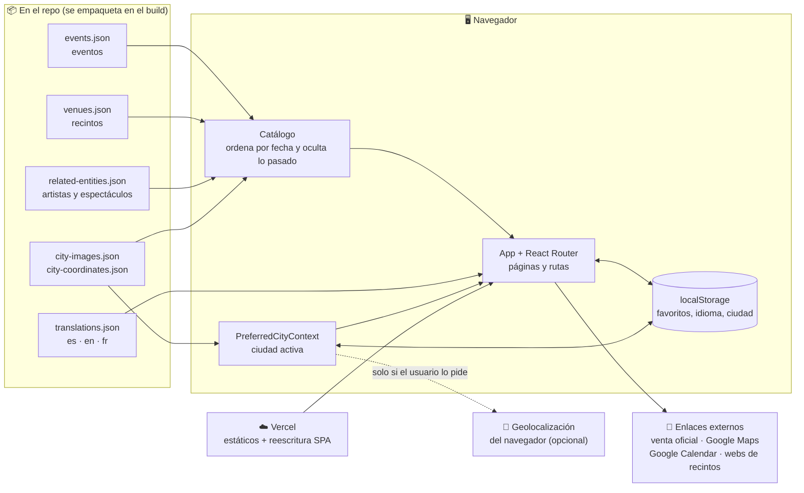
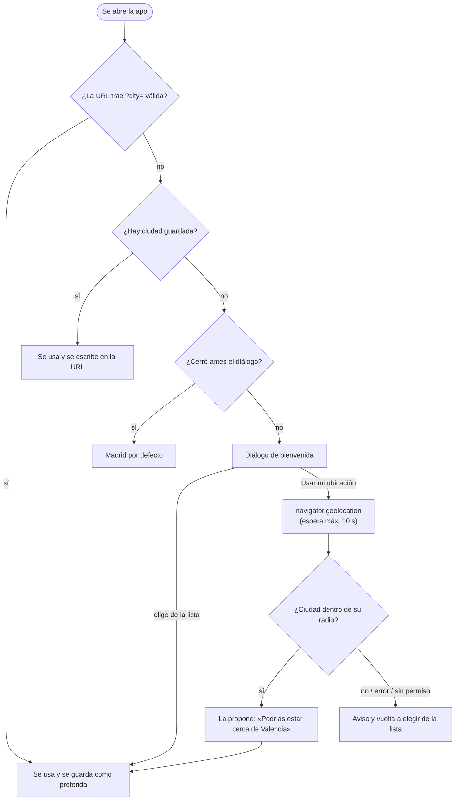
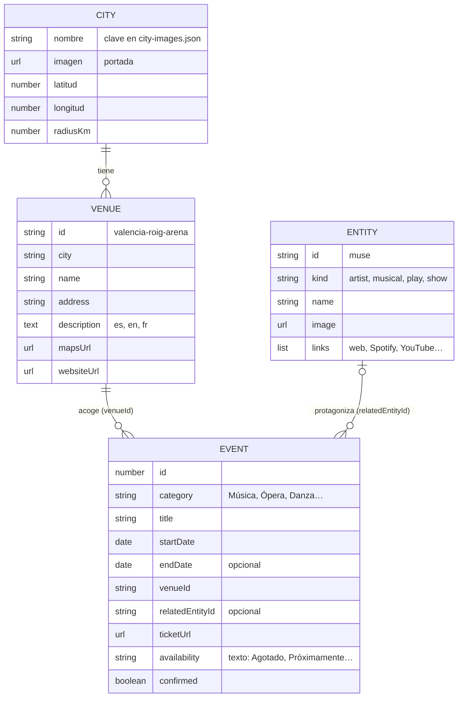

<div align="center">


# Plan Cerca

**Conciertos, teatro, ópera, danza, exposiciones y deporte en tu ciudad, en un solo sitio.**

*Concerts, theatre, opera, dance, exhibitions and sport in your city, all in one place.*


**[🌐 Abrir plancerca.com](https://plancerca.com)** · **[📸 Ver la app con capturas →](docs/GUIA-VISUAL.md)** · **[📖 Manual de uso](docs/MANUAL-DE-USO.md)**

</div>

---

## Qué es

Plan Cerca es una agenda cultural y deportiva para seis ciudades de España: **Madrid, Barcelona, Valencia, Sevilla, Bilbao y Albacete**. Eliges ciudad, ves qué hay hoy, mañana o este mes, guardas lo que te interesa y, desde cada ficha, llegas a la web oficial para comprar la entrada.

Es el proyecto de la asignatura de **Interacción Persona-Ordenador (HCI)**. Por eso pesan tanto la usabilidad, la accesibilidad y la jerarquía visual como las funciones: cada cambio importante salió de una revisión de uso.

> **En cifras (7 de noviembre de 2026):** 185 eventos próximos, 44 recintos y 11 fichas de artista o espectáculo. Los eventos que ya han pasado se ocultan solos.

## Lo más interesante, en 30 segundos

| | |
|---|---|
| 🗂️ **Sin backend** | Todo el catálogo son ficheros JSON dentro del repo y las preferencias van en `localStorage`. Se despliega como una web estática y no hay servidor que mantener. |
| 📍 **Ciudad con criterio** | Manda el `?city=` de la URL; si no hay, la ciudad guardada; si tampoco, un diálogo de bienvenida que puede usar tu ubicación (distancia *haversine* al centro de cada ciudad, con un radio por ciudad). |
| 🔗 **La URL es el estado** | Ciudad, búsqueda, categorías y fechas viven en la URL. Cualquier vista se puede compartir, y Atrás devuelve a la misma posición de la página. |
| 🔍 **Búsqueda que perdona** | Ignora tildes y mayúsculas, busca en título, recinto, organizador y etiquetas, y si en tu ciudad no hay nada te dice en qué otras ciudades sí. |
| 📅 **Ficha completa** | Añadir al calendario (Google o `.ics` con la hora de Madrid bien calculada), compartir con el menú nativo del móvil y datos estructurados de schema.org para buscadores. |
| ♿ **Accesible de serie** | Enlace para saltar al contenido, foco gestionado al cambiar de página, diálogos con foco atrapado, `aria-pressed` y `aria-live`, y respeto a «reducir movimiento». |
| 🤖 **Legible por máquinas** | `llms.txt` y `ai-catalog.json` describen el sitio para agentes de IA; `robots.txt` deja fuera favoritos y búsquedas. |
| 🌍 **Tres idiomas** | Español, inglés y francés, también en los textos de recintos y artistas. El atributo `lang` del documento cambia con el idioma. |

---

## Índice

1. [Arquitectura](#-arquitectura)
2. [Qué pasa al abrir la app: elegir ciudad](#-qué-pasa-al-abrir-la-app-elegir-ciudad)
3. [Herramientas](#-herramientas)
4. [La URL como estado](#-la-url-como-estado)
5. [Datos](#-datos)
6. [Búsqueda, filtros y recomendaciones](#-búsqueda-filtros-y-recomendaciones)
7. [La ficha de evento](#-la-ficha-de-evento)
8. [Idiomas](#-idiomas)
9. [Accesibilidad](#-accesibilidad)
10. [Buscadores y agentes de IA](#-buscadores-y-agentes-de-ia)
11. [Rendimiento](#-rendimiento)
12. [Despliegue](#-despliegue)
13. [Arrancarlo en local](#-arrancarlo-en-local)
14. [Estructura del repositorio](#-estructura-del-repositorio)
15. [Estado y qué falta](#-estado-y-qué-falta)
16. [Créditos de las imágenes](#-créditos-de-las-imágenes)

---

## 🧱 Arquitectura

Es una SPA de React servida como estáticos desde Vercel. No hay API propia: los datos se importan como módulos JSON en el build y lo que elige el usuario se queda en su navegador. Hacia fuera solo salen enlaces (venta de entradas, mapas, calendario) e imágenes.



**Decisiones que se notan:**

- **Datos en el bundle, no en una API.** Con unos cientos de eventos curados a mano, un JSON tipado es más simple que una base de datos y hace que la web cargue sin esperas de red.
- **Un contexto, no una librería de estado.** Lo único compartido de verdad es la ciudad activa (`PreferredCityContext`). El resto vive en la URL o en estado local de cada página.
- **`ErrorBoundary` en la raíz.** Si algo falla al renderizar, se muestra una página de error traducida con un enlace a la portada en vez de una pantalla en blanco.

---

## 📍 Qué pasa al abrir la app: elegir ciudad

La ciudad decide todo lo que se ve, así que hay un orden de prioridad claro. La ubicación **nunca se pide sin que el usuario pulse** «Usar mi ubicación».



- **Distancia real.** `cityNearCoordinates` calcula la distancia *haversine* a cada ciudad y solo acepta la más cercana si está dentro de su `radiusKm` (de 65 a 80 km según la ciudad, en `city-coordinates.json`).
- **Nunca se queda «buscando».** Un temporizador de 10 s cubre el caso de que el navegador no responda ni sí ni no al permiso.
- **Un enlace compartido manda.** Si llega un `?city=` distinto (por ejemplo, desde un enlace o con Atrás), sustituye a la ciudad guardada.
- **Cambiar de ciudad desde una ficha** (evento, artista o favoritos) lleva a la portada, porque esa ficha puede no existir en la nueva ciudad.

---

## 🧰 Herramientas

| Capa | Tecnología | Por qué |
|---|---|---|
| UI | **React 19** | Componentes y estado local; nada más hace falta |
| Rutas | **React Router 7** | URLs reales, compartibles y con historial |
| Lenguaje | **TypeScript 5.7** | Los JSON se leen con tipos propios (`EventItem`, `Venue`, `City`…), así que el código que los usa está comprobado |
| Estilos | **Tailwind CSS 4** + CSS propio (`src/index.css`) | Tema oscuro con acento violeta, variables por categoría y *media queries* para móvil |
| Build | **Vite 8** | Arranque instantáneo y recarga en caliente |
| Formato | **oxfmt** | Formateador rápido, sin configuración |
| Tipografías | **DM Sans** y **Manrope** (Google Fonts) | Cargadas con `preconnect` + `<link>`, sin `@import` que bloquee |
| Despliegue | **Vercel** | Estáticos con reescritura SPA y cabeceras propias |
| Origen | **Figma Make** | El prototipo inicial salió de ahí; quedan sus *plugins* de Vite en `vite.config.ts` |

**Sin dependencias extra:** no hay librería de estado, ni de fechas, ni de iconos, ni de i18n. Los iconos son SVG propios (`Icon.tsx`) y las fechas se calculan con `Intl` nativo.

---

## 🔗 La URL como estado

Todo lo que define «qué estoy viendo» está en la URL, así que copiar la barra de direcciones es compartir exactamente esa vista.

| Parámetro | Ejemplo | Qué hace |
|---|---|---|
| `city` | `?city=Sevilla` | Ciudad activa |
| `q` | `/search?q=rock` | Texto buscado |
| `cat` | `&cat=Música,Teatro` | Categorías marcadas (se pueden combinar) |
| `when` | `&when=week` | `today`, `tomorrow`, `week` (hasta el domingo), `month` (30 días) o una fecha `AAAA-MM-DD` |
| `filters` | `&filters=1` | Abre la pantalla de filtros sobre la búsqueda actual |

| Ruta | Página |
|---|---|
| `/` | Portada con la agenda de la ciudad |
| `/search` | Resultados de búsqueda, o filtros si no hay `q` |
| `/event/:id` | Ficha de evento (o aviso de «ya ha pasado») |
| `/venues` · `/venues/:id` | Directorio y ficha de recinto |
| `/artist/:slug` · `/entity/:slug` | Ficha de artista, musical o espectáculo |
| `/favorites` | Favoritos |
| `*` | Página 404 traducida |

**Detalles de navegación:**

- **Scroll restaurado por entrada del historial.** La app desactiva la restauración del navegador y guarda la posición de cada página: Atrás vuelve exactamente donde estabas y una página nueva empieza arriba.
- **«Volver» con red de seguridad.** Si llegaste por un enlace directo (no hay historial dentro de la app), «Volver» te lleva a la portada en lugar de sacarte del sitio.
- **Cambiar de categoría o fecha no ensucia el historial** (`replace`), así que Atrás no recorre cada clic de filtro.
- **Paginación que se acuerda.** El catálogo muestra 12 eventos por tanda; si cargas más, entras en una ficha y vuelves, siguen cargados.

---

## 📦 Datos

Tres ficheros JSON relacionados por identificadores. Los textos de recintos y fichas están en los tres idiomas (`{ es, en, fr }`).



- **La lista de ciudades sale de los datos.** El tipo `City` es `keyof typeof cityImages`: añadir una clave a `city-images.json` crea la ciudad en el selector, los contadores y los filtros, sin tocar código.
- **Los JSON no se validan al compilar.** Se leen con un `as EventItem[]`, así que un campo mal escrito no da error de TypeScript. Un `venueId` que no existe sí se nota: rompe la carga de la app (ver el [manual](docs/MANUAL-DE-USO.md#para-quien-mantiene-la-app)).
- **Lo pasado se filtra al cargar.** `event-catalog.ts` ordena por fecha y separa los eventos terminados. Su ficha sigue existiendo (los enlaces viejos no dan 404) y muestra «Este evento ya ha pasado» con tres eventos parecidos.
- **La disponibilidad es texto con significado.** «Agotado» oculta el botón de compra y pinta el estado en rojo; un evento no confirmado sale como «pendiente»; «Consultar…» es neutro. Solo es verde cuando hay entradas.
- **Origen de los datos.** Curados a mano desde las fichas oficiales (Ticketmaster, Live Nation, webs de los recintos), con su imagen y texto. Cada evento enlaza a la venta oficial: Plan Cerca no vende entradas.

---

## 🔍 Búsqueda, filtros y recomendaciones

- **Búsqueda sin tildes.** Texto y consulta se normalizan (NFD, sin diacríticos, en minúsculas): «opera» encuentra «Ópera». Se busca en título, categoría, descripción, organizador, recinto, dirección y etiquetas.
- **Si no hay nada aquí, mira allí.** Cuando la búsqueda no da resultados en tu ciudad pero sí en otras, se ofrecen botones «Valencia · 1» que repiten la búsqueda allí con los mismos filtros.
- **Rangos de fecha por solapamiento.** Un evento de varios días entra en «Esta semana» si alguno de sus días cae dentro, no solo el primero.
- **Atajos con recuento.** Hoy, Mañana, Esta semana y Próximos 30 días muestran cuántos planes hay y se desactivan cuando son cero, para no llevar a una lista vacía.
- **Filtros que avisan antes.** El botón de la pantalla de filtros dice cuántos resultados vas a ver («Ver resultados · 12») y, si escribes una ciudad sin eventos, sugiere las que sí tienen.
- **Recomendados sin repetir artista.** Los tres destacados priorizan los eventos marcados como `featured` y descartan un segundo concierto del mismo artista, para que no salgan tres fechas de la misma gira.
- **Franja de descubrimiento.** Las tres categorías con más eventos en la ciudad, cuántos hay esta semana y el evento mejor valorado.

---

## 🎫 La ficha de evento

| Acción | Cómo funciona |
|---|---|
| **Comprar** | Enlace a la venta oficial. Desaparece si el evento está agotado o ya pasó |
| **Compartir** | `navigator.share` (menú nativo del móvil). Si no existe o falla, copia el enlace |
| **Copiar enlace** | API del portapapeles con *fallback* a `execCommand("copy")` para navegadores antiguos; confirma con «Enlace copiado» |
| **Añadir al calendario** | Google Calendar (enlace con plantilla) o archivo `.ics` para Outlook y Apple Calendar |
| **Guardar** | Corazón con `aria-pressed`; se guarda en `localStorage` |

**El calendario, bien hecho:**

- **Hora de Madrid, no la del navegador.** Las horas de los eventos son locales de España. `madridDateTime` convierte a UTC con `Intl.DateTimeFormat` y `timeZone: "Europe/Madrid"`, así que el evento sale a su hora aunque abras la ficha desde otro huso o en el día del cambio de hora.
- **Duración leída del texto.** «2 h 15 min aprox.» se convierte en la hora de fin; si no hay duración, se suponen 2 horas.
- **Eventos de día completo** (exposiciones, varios días) usan fechas sin hora y el final exclusivo que exige iCalendar.
- **Texto escapado** según la norma (comas, puntos y coma, saltos de línea) para que el `.ics` no se rompa con títulos como «Schubert, Brahms, Rossini».

Además, cada ficha incluye un bloque **JSON-LD de schema.org** (`Event`, `Place`, `Offer`) con precio, disponibilidad (`InStock`, `SoldOut`, `PreOrder`) y dirección, para que los buscadores puedan mostrarlo como evento.

---

## 🌍 Idiomas

- **Español, inglés y francés** en toda la interfaz (`translations.json`: textos de interfaz, categorías, errores, diálogo de bienvenida y acciones de la ficha).
- Los **recintos** traen su tipo y descripción en los tres idiomas, y las fichas de artista también traducen los títulos de sección y de enlace.
- Los **títulos y descripciones de eventos** están en español, que es como los publican los organizadores.
- El idioma se recuerda en el navegador y se aplica al `lang` del `<html>`, para que los lectores de pantalla pronuncien bien.
- Plurales con su palabra propia en cada idioma («1 evento» / «2 eventos»).

<div align="center">

</div>

---

## ♿ Accesibilidad

Como proyecto de HCI, la accesibilidad se trató como requisito y no como repaso final:

- **Enlace «Saltar al contenido»** y **foco movido al `<main>`** en cada cambio de página, para que el lector de pantalla no se quede en el menú.
- **Diálogos accesibles.** El de bienvenida y el de «Acerca de» tienen `role="dialog"`, `aria-modal`, título enlazado, cierre con Escape y foco atrapado: Tab no se escapa a la página de detrás. Al cerrar «Acerca de», el foco vuelve al botón que lo abrió.
- **Estados anunciados.** Botones de alternar con `aria-pressed` (guardar, categorías, seguir), contador del carrusel con `aria-live` y mensajes de «sin resultados» con `role="status"`.
- **Reducir movimiento.** Con `prefers-reduced-motion` se quitan las animaciones y el desplazamiento suave, también en los botones del carrusel.
- **Imágenes que no rompen la página.** `FallbackImage` pinta un fondo del tema con el icono de la categoría si una imagen externa falla, incluido el caso de que falle antes de que React la monte.
- **Contraste revisado** en el tema oscuro, con especial cuidado en móvil.
- **Selector de ciudad** con cierre por Escape o clic fuera y foco devuelto al botón.

---

## 🤖 Buscadores y agentes de IA

| Pieza | Para qué |
|---|---|
| `document.title` por página | «Muse – The Wow! Signal Europa Tour · Plan Cerca», útil en pestañas e historial |
| `<meta name="description">` | Vista previa en buscadores y redes |
| JSON-LD `schema.org/Event` | Resultados enriquecidos de eventos |
| [`public/llms.txt`](public/llms.txt) | Resumen del sitio en Markdown para modelos de lenguaje: páginas principales y cómo interpretar precios y disponibilidad |
| [`public/ai-catalog.json`](public/ai-catalog.json) | Índice JSON de páginas y colecciones (por ejemplo, la plantilla `?city={city}` con sus valores) |
| [`public/robots.txt`](public/robots.txt) | Permite todo salvo `/favorites` y `/search`, que son personales o infinitas |

---

## ⚡ Rendimiento

- **Sin peticiones de datos.** El catálogo viaja en el JavaScript; al abrir la portada ya está todo.
- **Fuentes sin cadena bloqueante.** Se pasó de `@import` en el CSS a `preconnect` + `<link>` en el HTML.
- **Imágenes con prioridad.** La portada y la imagen principal de cada ficha llevan `fetchpriority="high"`; las tarjetas usan `loading="lazy"` y `decoding="async"`, y todas tienen ancho y alto para no mover la maqueta al cargar.
- **Catálogo por tandas** de 12 tarjetas en vez de pintar cientos de golpe.

---

## 🚀 Despliegue

Producción en **Vercel**, en [plancerca.com](https://plancerca.com). [`vercel.json`](vercel.json) hace dos cosas:

- **Reescribe todas las rutas a `index.html`**, para que `/event/89` funcione al recargar o al abrirlo desde un enlace (React Router resuelve la ruta en el navegador).
- **Fija el `Content-Type`** de `llms.txt`, `ai-catalog.json` y `robots.txt` con `charset=utf-8`, para que las tildes no lleguen rotas.

El título, la descripción y el idioma del HTML se configuran en `.figma/make/site.json` y un *plugin* de Vite los inyecta al construir.

---

## 💻 Arrancarlo en local

Necesitas **Node 22** y **pnpm 10** (versiones fijadas en [`.mise.toml`](.mise.toml)).

```bash
pnpm install
pnpm dev          # http://localhost:8443 (o el puerto de la variable PORT)
```

| Script | Qué hace |
|---|---|
| `pnpm dev` | Servidor de desarrollo con recarga en caliente |
| `pnpm build` | Build de producción en `dist/` |
| `pnpm preview` | Sirve el build localmente |
| `pnpm format` | Formatea el código con oxfmt |

No hace falta ninguna clave ni variable de entorno. Cómo añadir eventos, recintos o ciudades está en el **[manual de uso](docs/MANUAL-DE-USO.md#para-quien-mantiene-la-app)**.

---

## 📁 Estructura del repositorio

```
src/
├── App.tsx                      Rutas y páginas: portada, búsqueda, filtros, fichas, recintos, favoritos
├── main.tsx                     Arranque: ErrorBoundary → BrowserRouter → PreferredCityProvider → App
├── index.css                    Tailwind, tema oscuro, categorías por color y diseño móvil
├── components/
│   ├── CityOnboardingDialog.tsx Diálogo de bienvenida y geolocalización
│   ├── CitySelector.tsx         Selector de ciudad de la cabecera
│   ├── FallbackImage.tsx        Imagen con reserva si falla la carga
│   ├── ErrorBoundary.tsx        Página de error traducida
│   ├── StatusPage.tsx           404 y «evento pasado»
│   └── Icon.tsx                 Iconos SVG propios
├── context/
│   └── PreferredCityContext.tsx Ciudad activa: URL, preferencia guardada y ubicación
├── data/
│   ├── events.json              Eventos
│   ├── venues.json              Recintos
│   ├── related-entities.json    Artistas, musicales y espectáculos
│   ├── city-images.json         Ciudades y su imagen de portada
│   ├── city-coordinates.json    Centro y radio de cada ciudad
│   ├── translations.json        Textos en es, en y fr
│   └── *.ts                     Acceso tipado: catálogo, recintos, idioma, preferencias de artista
└── types/Event.ts               Tipos de evento, recinto, ciudad, categoría y ficha
public/                          favicon, robots.txt, llms.txt, ai-catalog.json
docs/                            Guía visual, manual de uso y capturas
```

---

## 📌 Estado y qué falta

**Hecho:** seis ciudades con portada nocturna propia · búsqueda y filtros por categoría y fecha · fichas de evento, recinto y artista · favoritos · calendario y compartir · tres idiomas · tema oscuro con animaciones que respetan «reducir movimiento» · accesibilidad revisada · datos para buscadores y agentes · despliegue en Vercel.

**Pendiente o mejorable:**

- **Sin pruebas automáticas.** Lo más delicado (rangos de fecha, hora de Madrid en el `.ics`, resolución de ciudad) merece pruebas unitarias.
- **«Seguir artista» y «Avisarme» solo guardan la preferencia** en el navegador. No hay notificaciones de verdad porque no hay backend que las envíe.
- **«Invitado» es un marcador de posición.** No hay cuentas, así que los favoritos no pasan de un dispositivo a otro.
- **Datos curados a mano.** Cada evento se añade editando `events.json`; precios y disponibilidad pueden quedarse atrás respecto a la web oficial.
- **`App.tsx` y `index.css` son grandes** (unas 770 líneas y casi 100 KB). Separar páginas y estilos facilitaría el mantenimiento.
- **Las imágenes dependen de webs ajenas.** Portadas, carteles y fotos de recintos se enlazan desde su origen; si una web cambia o bloquea el enlace, en las tarjetas `FallbackImage` pinta un icono, pero la portada de ciudad usa un `` normal y se queda en blanco. Ya pasó con la antigua foto de Madrid; por eso las portadas vienen ahora de Unsplash y Wikimedia Commons, que permiten enlazarlas.

---

## 📷 Créditos de las imágenes

Las portadas de ciudad son fotos nocturnas elegidas para que encajen con el tema oscuro y violeta de la app.

| Ciudad | Foto | Autor y licencia |
|---|---|---|
| Madrid | Edificio Metrópolis y Gran Vía con estelas de luz | Carlos Zurita · [Unsplash](https://unsplash.com/photos/MhlonjDt80A) · [Licencia Unsplash](https://unsplash.com/license) |
| Barcelona | Plaza de España y Montjuïc de noche | Javier Bosch · [Unsplash](https://unsplash.com/photos/C6oFJKusQPs) · [Licencia Unsplash](https://unsplash.com/license) |
| Valencia | Hemisfèric y Palau de les Arts iluminados | David Ferris · [Wikimedia Commons](https://commons.wikimedia.org/wiki/File:Nightwalk_to_the_City_of_Arts_and_Sciences_(Valencia)_-_Spain_Paseo_hacia_la_ciudad_de_las_artes_y_las_ciencias_(32244618773).jpg) · [CC BY 2.0](https://creativecommons.org/licenses/by/2.0/) |
| Sevilla | Las Setas (Metropol Parasol) y la Giralda de noche | María López Jorge · [Unsplash](https://unsplash.com/photos/KxjMODCJ42s) · [Licencia Unsplash](https://unsplash.com/license) |
| Bilbao | Museo Guggenheim y la ría de noche | Niclas Dehmel · [Unsplash](https://unsplash.com/photos/bAfk_mr8VU4) · [Licencia Unsplash](https://unsplash.com/license) |
| Albacete | Feria de Albacete: Puerta de Hierros y guirnaldas de luces | Ángel Aroca Escámez · [Wikimedia Commons](https://commons.wikimedia.org/wiki/File:Feria_de_albacete_puertas_de_hierro_de_noche.JPG) · [CC BY-SA 4.0](https://creativecommons.org/licenses/by-sa/4.0/) |

Los carteles de eventos y las fotos de recintos y artistas pertenecen a sus organizadores, recintos o artistas, y se enlazan desde sus webs oficiales.

---

<div align="center">

Proyecto académico de la asignatura de **Interacción Persona-Ordenador (HCI)**. 🎭

<sub>Las entradas, precios y horarios definitivos son siempre los de la web oficial de cada evento. Desarrollado con ayuda de <a href="https://claude.com/claude-code">Claude Code</a>.</sub>

</div>
